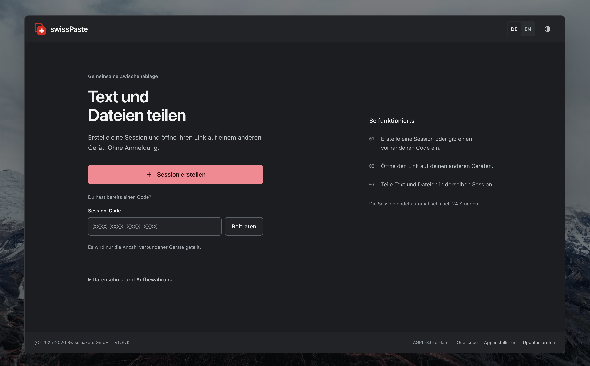
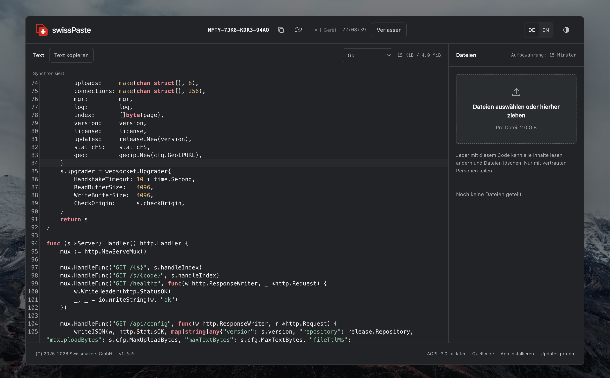

# swissPaste

swissPaste is a self-hosted shared clipboard and file exchange. Browsers join a session with a code or link, then share text and files. The application runs as a single Go binary with embedded web assets. It requires no database or external frontend service.

[Deployment](docs/DEPLOYMENT.md) | [Configuration](docs/CONFIGURATION.md) | [Contributing](CONTRIBUTING.md) | [Releases](docs/RELEASES.md)



<details>
<summary>View a shared session with Go syntax highlighting</summary>



</details>

## How it works

Create a session in one browser and open its link in another. Select **Show QR code** beside the session code to join from a phone camera, or use **Copy link** to share the complete session URL. Text and the editor's syntax language synchronize over WebSocket. Files remain available until they expire or a participant deletes them. Each session has its own document, language selection, file list and connected device count.

| Area | Behavior |
| --- | --- |
| Access | A 16-character session code grants read, write and file deletion access. |
| Retention | Files expire after 15 minutes. Sessions expire 24 hours after creation. |
| Capacity | The supplied deployment allows 2 GiB per file and 4 GiB of files across all sessions. |
| Storage | Text and session state stay in memory. The supplied deployment stores uploads on tmpfs. |
| Interface | English and German, light and dark themes, keyboard controls and responsive layouts. |
| File previews | Images, PDFs, highlighted text and code, and browser-supported audio and video. |
| Privacy | Participant details are disabled by default. Browser assets are served by the application. |
| Updates | A manual check compares the installed version with stable GitHub tags. |

> [!IMPORTANT]
> A server restart discards all sessions and uploads. swissPaste provides temporary exchange, with no persistent accounts or content history.

## Preview shared files

Select a filename in the file list to open its preview. The preview dialog keeps **Download** available. The download icon beside the filename also saves the file directly. Close the dialog with its close button or `Esc`.

| Format | Preview behavior |
| --- | --- |
| Images | PNG, JPEG, GIF, WebP, AVIF, BMP and ICO, subject to browser support. |
| PDF | Page rendering with previous and next page controls. |
| Text and source code | Read-only UTF-8 text with syntax highlighting selected from the filename. HTML and SVG appear as source text. |
| Audio and video | Browser playback controls when the browser supports the codec. |
| Other files | Download option with an explanation that no preview is available. |

Text previews accept up to 1 MiB. Image, PDF, audio and video previews accept up to 32 MiB. Larger files remain downloadable within the configured upload limits. Damaged files, encrypted PDFs and unsupported encodings or codecs can require a download. Previews run in the browser using locally served code and require no external conversion service.

## Quick start

This procedure builds the application and exposes it on the host at `http://127.0.0.1:3002`.

**Prerequisites**

- A checkout of this repository.
- Podman with a Compose provider and a working container user namespace.
- Network access to fetch container images and build dependencies.
- Port 3002 available on loopback.

**Procedure**

1. Build and start the service from the repository root. The container build generates the editor bundle, background images and application icons.

   ```bash
   podman compose up --build --detach
   ```

2. Verify that the application responds. The endpoint returns `ok`.

   ```bash
   curl --fail http://127.0.0.1:3002/healthz
   ```

3. Open [swissPaste](http://127.0.0.1:3002) on the same host and create a session.
4. Open the session link in a second browser on that host to verify text and file exchange.

The supplied [Compose configuration](compose.yml) runs as user `65532:65532` with a read-only root filesystem, dropped capabilities, no-new-privileges and a 4 GiB tmpfs spool. The loopback address is accessible only from the host. For access from other devices, configure HTTPS through the [reverse proxy procedure](docs/DEPLOYMENT.md#configure-a-reverse-proxy).

## Operating model

Run one server process per instance. Session state is local to that process and is not shared between replicas. Restarting or replacing the container interrupts all sessions. Use [Quadlet](docs/DEPLOYMENT.md#configure-startup-after-reboot) when the service must start after a host reboot.

The session code is the access secret. Share it only with intended participants, use HTTPS outside loopback and keep session URLs out of proxy logs. The server can read shared content. See [security and data retention](docs/REVIEW.md) for the access model and storage boundaries.

Text synchronization uses the most recent write accepted by the server. Simultaneous edits can overwrite each other. While disconnected, the editor is read-only. Unacknowledged text can be recovered from the current tab's memory, but closing or reloading the tab can lose that text.

The syntax language selector follows the same session across participants, page reloads and reconnects. The server accepts language changes in arrival order. The selector is disabled while disconnected. Interface language and appearance are personal preferences.

## Browser installation and appearance

In a supported browser, select **Install app** in the footer or use the browser's installation menu. Installation requires HTTPS or a loopback address. On iPhone or iPad, use **Add to Home Screen** from the share menu. The installed app opens the home page without a session code. It requires a connection to the server and does not provide offline sessions.

On phones, **Text** and **Files** tabs switch between the editor and file list. The file count updates when another participant uploads a file. Desktop layouts show both panels together.

The interface uses the system's light or dark preference initially. The theme button switches between those two themes and remembers the choice when browser storage is available. Each full page reload selects a background image. See [asset management](docs/ASSETS.md) to replace the photographs, logo or icons.

If Samsung Internet reports that the installed app targets an older Android version, follow the [installation troubleshooting procedure](docs/PWA.md#samsung-internet-reports-an-outdated-android-app). This warning concerns the browser-generated Android package. Changing a web manifest cannot set that package's target SDK.

## Documentation

| Guide | Contents |
| --- | --- |
| [Deployment](docs/DEPLOYMENT.md) | Candidate validation, container replacement, rollback, systemd startup and HTTPS proxy configuration. |
| [Configuration](docs/CONFIGURATION.md) | Environment variables, application defaults and resource budgets. |
| [Security and data retention](docs/REVIEW.md) | Session access, content lifetime, privacy and regression coverage. |
| [Asset management](docs/ASSETS.md) | Background processing, logo generation and third-party credits. |
| [Browser installation](docs/PWA.md) | Installation requirements, metadata, privacy boundaries and Samsung Internet troubleshooting. |
| [Contributing](CONTRIBUTING.md) | Local builds, source conventions, documentation policy and verification. |
| [Releases](docs/RELEASES.md) | Version metadata, stable tags, publication and update checks. |

## License

Copyright (C) 2025-2026 [Swissmakers GmbH](https://swissmakers.ch). Author: Michael André Reber.

swissPaste is licensed under [AGPL-3.0-or-later](LICENSE)
